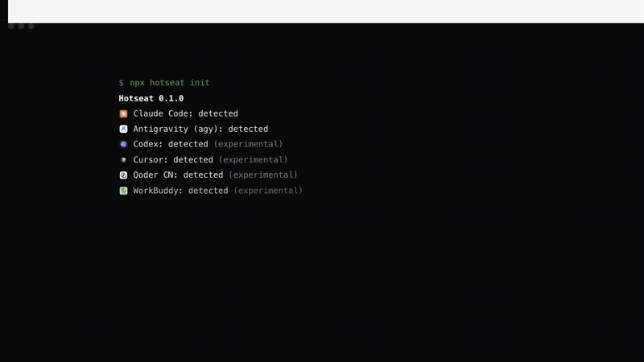

<div align="center">


# Hotseat 同桌

**Switch AI agents mid-task. The next one already knows.**

One command gives almost every major coding agent, from Claude Code, Codex, Cursor, Copilot and Gemini CLI to WorkBuddy, Kimi Code, Qwen Code and Qoder, a shared, local task context.<br>
No more "summarize what you did" and "read the folder first".

English · [简体中文](README.zh-CN.md)

<a href="https://github.com/ntu-zjy/hotseat/releases/download/demo-video/hotseat-demo-en.mp4"></a>


https://github.com/user-attachments/assets/346c380a-d7b8-4623-b454-60d136abecd2


▶ [Watch the full demo with sound](https://github.com/ntu-zjy/hotseat/releases/download/demo-video/hotseat-demo-en.mp4) (78 s) · [中文版](https://github.com/ntu-zjy/hotseat/releases/download/demo-video/hotseat-demo-zh.mp4)

</div>

---

## The problem

You're halfway through a task in Claude and hit your usage limit. Or the discussion is done and you want another agent to write the code. So you:

1. ask the current agent to summarize (if it still can),
2. open the other agent,
3. tell it to read the folder, wait, then correct what it got wrong.

The summary drops what matters most: **why** a decision was made, **what was already tried and rejected**, **what you asked for along the way**, and **what was left half-done**. When you switch back, the first agent has no idea what the second one did.

## What Hotseat does

```bash
npx hotseat init
```

After that, every agent works on the same task record:

- **Handoff is automatic.** When a session starts, a hook injects the task's goal, constraints, decisions, rejected approaches, half-done state and next steps. You just say "continue".
- **Nothing is lost at the end of a turn.** If an agent changed files but didn't record progress, a stop hook asks it to, once, before it finishes.
- **Coming back shows only what changed.** "Since you left" lists what other agents did after you last saw the task.
- **Every line has a source.** `hotseat blame "token refresh"` shows which agent wrote a decision, when, and who confirmed it.
- **You stay in charge of long-term memory.** Agents *propose* edits to `memory.md`; you accept or reject them with `hotseat review`.

Think of it as **Git for agent context**: each agent's progress record is a commit, "since you left" is a diff, and every line can be blamed.

## What the next agent sees

Injected at the start of a new session (trimmed):

```markdown
# Hotseat handoff · Login refresh (auth-refresh)
> You are agy. Last record: codex · 11-23 14:02. This was injected automatically; no need to call get_context. Call record_progress before ending this turn.

## Since you left (3 new records)
- Token refresh implemented, unit tests pass; changed src/auth/interceptor.ts 〔codex · 11-23 14:02〕
- memory.md: new constraint "don't change the /api/v1 response format"
- plan.md: T3 doing → done

## Goal
- Refresh expired logins automatically, invisible to the user

## Constraints (must follow)
- Don't change the /api/v1 response format 〔codex · 11-23 14:02〕

## Half-done state / next steps
- Half-done: login page error message isn't wired up 〔codex · 11-23 14:02〕
- Next: wire up the error message; add an integration test

## Key decisions
- Refresh inside the request interceptor — so each call doesn't handle it separately

## Rejected approaches
- Refresh early on a timer — multiple tabs refresh twice
```

The pack is built per agent, ordered by what matters for the job, and capped (about 5,000 tokens by default; real tasks are usually 2,000–3,500).

## Supported tools

<table>
<tr><td align="center" width="110"><br><sub><b>Claude Code</b></sub><br><sub>✅</sub></td><td align="center" width="110"><br><sub><b>Antigravity</b></sub><br><sub>✅</sub></td><td align="center" width="110"><br><sub><b>Codex</b></sub><br><sub>✅</sub></td><td align="center" width="110"><br><sub><b>Cursor</b></sub><br><sub>✅</sub></td><td align="center" width="110"><br><sub><b>GitHub Copilot</b></sub><br><sub>🧪</sub></td><td align="center" width="110"><br><sub><b>Gemini CLI</b></sub><br><sub>🧪</sub></td><td align="center" width="110"><br><sub><b>Windsurf</b></sub><br><sub>🧪</sub></td></tr>
<tr><td align="center" width="110"><br><sub><b>Kiro</b></sub><br><sub>🧪</sub></td><td align="center" width="110"><br><sub><b>OpenCode</b></sub><br><sub>🧪</sub></td><td align="center" width="110"><br><sub><b>Cline</b></sub><br><sub>🧪</sub></td><td align="center" width="110"><br><sub><b>Kilo Code</b></sub><br><sub>🧪</sub></td><td align="center" width="110"><br><sub><b>WorkBuddy</b></sub><br><sub>🧪</sub></td><td align="center" width="110"><br><sub><b>CodeBuddy</b></sub><br><sub>🧪</sub></td><td align="center" width="110"><br><sub><b>Kimi Code</b></sub><br><sub>🧪</sub></td></tr>
<tr><td align="center" width="110"><br><sub><b>Qwen Code</b></sub><br><sub>🧪</sub></td><td align="center" width="110"><br><sub><b>Qoder</b></sub><br><sub>🧪</sub></td><td align="center" width="110"><br><sub><b>Qoder CN</b></sub><br><sub>🧪</sub></td><td align="center" width="110"><br><sub><b>Tongyi Lingma</b></sub><br><sub>🧪</sub></td><td align="center" width="110"><br><sub><b>Trae</b></sub><br><sub>🧪</sub></td><td align="center" width="110"><br><sub><b>Trae CN</b></sub><br><sub>🧪</sub></td><td align="center" width="110"><br><sub><b>iFlow CLI</b></sub><br><sub>🧪</sub></td></tr>
</table>

✅ tested · 🧪 experimental: built from each tool's official docs, not yet tested end to end. Names and logos belong to their owners.

<details>
<summary>What each tool gets (MCP, rules, automatic handoff, stop check)</summary>

| Tool | Status | MCP | Rules | Context on session start | Stop check |
|---|---|:-:|:-:|:-:|:-:|
| Claude Code (incl. the Code tab in the Claude desktop app) | ✅ tested | ✅ | ✅ | ✅ | ✅ |
| Antigravity / agy (IDE, app and CLI) | ✅ tested | ✅ | ✅ | ✅ | ✅ |
| Codex (CLI and desktop app) | ✅ tested | ✅ | ✅ | ✅ ¹ | ✅ ¹ |
| Cursor | ✅ tested | ✅ | manual ² | ✅ | ✅ |
| Qoder CN (desktop app and CLI) | 🧪 experimental | ✅ | ✅ | ✅ | ✅ |
| Qoder (global) | 🧪 experimental | ✅ | ✅ | ✅ | ✅ |
| WorkBuddy (Tencent) | 🧪 experimental | ✅ | ✅ | ✅ | ✅ |
| CodeBuddy Code (Tencent) | 🧪 experimental | ✅ | ✅ | ✅ | ✅ |
| Kimi Code (Moonshot) | 🧪 experimental | ✅ | ✅ | ✅ ³ | ✅ |
| Gemini CLI | 🧪 experimental | ✅ | ✅ | ✅ ⁴ | ✅ ⁴ |
| Qwen Code (Alibaba) | 🧪 experimental | ✅ | ✅ | ✅ | ✅ |
| Tongyi Lingma (Alibaba) | 🧪 experimental | manual ⁵ | manual ² | ✅ ³ | ✅ |
| Trae / Trae CN (ByteDance) | 🧪 experimental | manual ⁵ | manual ² | via rules | — |
| GitHub Copilot (CLI, app and VS Code) | 🧪 experimental | ✅ | ✅ | via rules | — |
| Cline (CLI and VS Code / Cursor / Windsurf extension) | 🧪 experimental | ✅ | ✅ | via rules | — |
| Kilo Code | 🧪 experimental | ✅ ⁶ | ✅ | via rules | — |
| iFlow CLI | 🧪 experimental | ✅ | ✅ | via rules | — |
| Windsurf | 🧪 experimental | ✅ | ✅ | via rules | — |
| Kiro | 🧪 experimental | ✅ | ✅ | via rules | — |
| OpenCode | 🧪 experimental | ✅ | ✅ | via rules | — |
| Anything else that speaks MCP | manual setup | ✅ | your tool's rules file | via rules | — |

¹ Codex runs new hooks only after you trust them: type `/hooks` in Codex. The relay also works without hooks (Codex calls `get_context` itself, following the rules); that path is what has been tested, the hooks not yet in a real Codex.<br>
² These tools keep user rules in their settings. Run `hotseat rules` and paste the output there.<br>
³ These tools ignore output from a session-start hook, so the handoff is injected with your first message in each session (once).<br>
⁴ Gemini CLI: type `/hooks` to check that Hotseat's hooks are enabled.<br>
⁵ These tools only add MCP servers in their UI; `hotseat init` prints the JSON to paste.<br>
⁶ If `~/.config/kilo/kilo.jsonc` has comments, Hotseat leaves it alone and prints the snippet to paste.<br>
"Via rules": no hook, so the rules tell the agent to call `hotseat.get_context` itself when a session starts.

</details>

Your tool isn't listed? [Open an issue](../../issues). An adapter is one file.

## Quick start

Requires Node.js 22.13+. Tested on macOS; Linux should work; Windows isn't supported yet.

```bash
npx hotseat init          # detects your agents, shows every change, backs up each file, then writes
```

1. Restart your agents.
2. In your project folder, create a task, or just ask your agent to create one:
   ```bash
   hotseat new "Login refresh" --goal "Refresh expired logins automatically"
   ```
3. Work as usual. Switch agents whenever you like.

## Commands

| Command | What it does |
|---|---|
| `hotseat init` | Connect your agents (MCP server, rules, hooks). Shows changes first; `--dry-run` to only look |
| `hotseat doctor` | Check that every connection is still in place (e.g. after another tool rewrote your settings) |
| `hotseat new "<name>"` | Create a task bound to the current folder |
| `hotseat context` | Print the handoff the next agent would get |
| `hotseat review` | Accept or reject the memory and plan edits agents proposed |
| `hotseat blame "<words>"` | Find who wrote a decision or constraint, and when |
| `hotseat list` · `hotseat link <dir>` | List tasks · bind another folder to a task |
| `hotseat uninstall` | Remove everything Hotseat added. Your task data stays |

## Your data stays yours

- Everything lives in `~/Hotseat/tasks/<task>/` as plain files you can read and edit: `memory.md` (goal, decisions, constraints, rejected approaches), `plan.md` (subtasks), `events.jsonl` (append-only log), `progress.md`.
- **Local only.** No account, no API key, no telemetry. Hotseat never calls a model: the agent you already pay for does the writing.
- Secrets that look like API keys or tokens are redacted before anything is written.
- Hotseat doesn't read your chat history. It only sees what agents record through its MCP tools.

## Safe to try

- `init` shows exactly what it will add to each file and asks before writing. Every file is backed up to `~/Hotseat/.hotseat/backups/`.
- It merges into your existing configs and never replaces them. If another tool overwrites your settings later, `hotseat doctor` tells you.
- `hotseat uninstall` removes exactly what Hotseat added; config files are restored byte for byte (covered by tests).
- Hooks fail open: if anything goes wrong, they step aside within 1.5 seconds and never block your agent.

## How it works

| Piece | Role |
|---|---|
| **MCP server** | 11 tools: `get_context`, `record_progress`, `propose_memory_edit`, `search`, `create_task`, … |
| **Session-start hook** | Builds the handoff for *this* agent (what changed since it last looked) and injects it |
| **Stop hook** | If this turn changed files but nothing was recorded, asks the agent to record once |
| **Rules snippet** | Fallback for tools without hooks: "call `get_context` first, `record_progress` before finishing" |

Tasks are found by folder: open an agent in a bound folder and it's on that task.

## FAQ

**Isn't this just an `AGENTS.md` or `handoff.md`?**
A static file depends on someone remembering to update it and to read it. It can't tell you what changed since you left, and the reasons behind decisions are the first thing to go. Hotseat records each turn automatically and builds a fresh handoff for each agent.

**Does it work when my first agent is already out of quota?**
Yes, and that's the main case. Progress is recorded every turn, not at switch time, so the next agent gets everything up to the last turn.

**Can two agents work on the same task at the same time?**
Not yet. Hotseat is for taking turns. Parallel work (claiming subtasks, conflict warnings) is planned.

**How many tokens does it add?**
One handoff per new session, about 2,000–3,500 tokens for a real task, capped at about 5,000 by default.

## Status

Early, v0.x. Built in public by a solo developer who switches between Claude and Antigravity every day. Issues and adapter PRs are welcome.

## License

[Apache-2.0](LICENSE)
