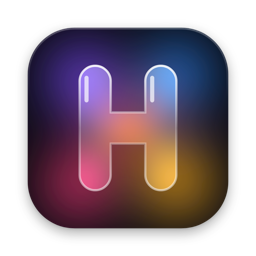

<div align="center">



# Hotseat 同桌

**换个 AI Agent 接着干，它已经什么都知道了。**

一条命令，让 Claude Code、Codex、Cursor、WorkBuddy、Kimi Code、Qwen Code、Qoder、通义灵码等国内外主流 Agent 共用同一份本地任务上下文。<br>
不用再说「总结一下」，也不用再说「先读一下文件夹」。

[English](README.md) · 简体中文

https://github.com/user-attachments/assets/83faeab8-de07-4dc1-8741-dad0870de4ac

▶ [看完整视频（71 秒，有配音和配乐）](https://github.com/ntu-zjy/hotseat/releases/download/demo-video/hotseat-demo-zh.mp4) · [English](https://github.com/ntu-zjy/hotseat/releases/download/demo-video/hotseat-demo-en.mp4)

</div>

---

## 你是不是也这样切换 Agent

在 Claude 里做到一半，额度用完了；或者方案讨论完了，想换个 Agent 写代码。于是你：

1. 让当前的 Agent 总结一下（前提是它还能用）；
2. 打开另一个 Agent；
3. 告诉它先读一下文件夹，等它读完，再纠正它理解错的地方。

总结里最容易丢的恰恰是最重要的：**为什么这么决定**、**哪些方案已经试过、否掉了**、**你中途提过的要求**、**做到一半的状态**。等你切回来，原来的 Agent 也不知道另一个做了什么。

## Hotseat 做什么

```bash
npx hotseat init
```

之后你用的每个 Agent 都在同一份任务记录上干活：

- **自动交接**：新会话一开始，Hook 就把任务的目标、约束、关键决定、放弃过的方案、做到一半的状态和下一步注入进去。你只要说「继续」。
- **每轮都不漏记**：Agent 这一轮改了文件却没记录进度，结束前会被提醒一次，补上再结束。
- **切回来只看变化**：「你离开后」列出你上次离开之后，别的 Agent 做了什么。
- **每一行都有出处**：`hotseat blame "token 刷新"` 查得到这条决定是哪个 Agent、什么时候写的，谁确认的。
- **长期记忆由你做主**：Agent 只能**提议**修改 `memory.md`，你用 `hotseat review` 逐条确认。

可以把它理解成 **Agent 上下文的 Git**：每个 Agent 的进度记录是 commit，「你离开后」是 diff，每一行都能 blame。

## 新 Agent 看到的是什么

新会话开头自动注入的内容（节选）：

```markdown
# Hotseat 交接 · 登录态刷新（auth-refresh）
> 你是 agy。上次记录：codex · 11-23 14:02。这份内容已经自动注入，不需要再调用 get_context；本轮结束前调用 record_progress。

## 你离开后（3 条新记录）
- 实现了 token 刷新，单测通过；改了 src/auth/interceptor.ts 〔codex · 11-23 14:02〕
- memory.md：新增约束「不要改动 /api/v1 的返回格式」
- plan.md：T3 进行中 → 完成

## 目标
- 登录过期后自动刷新，用户无感知

## 约束（必须遵守）
- 不要改动 /api/v1 的返回格式 〔codex · 11-23 14:02〕

## 做到一半 / 下一步
- 半截：登录页的错误提示还没接上 〔codex · 11-23 14:02〕
- 下一步：接错误提示；补集成测试

## 关键决定
- 刷新放在拦截器里 —— 避免每个请求各自处理

## 放弃过的方案
- 定时器提前刷新 —— 多标签页会重复刷新
```

交接内容按 Agent 分别生成，按这次要做的事排序，有长度上限（默认约 5000 token；真实任务一般 2000–3500）。

## 支持的工具

<table>
<tr><td align="center" width="110"><br><sub><b>Claude Code</b></sub><br><sub>✅</sub></td><td align="center" width="110"><br><sub><b>Antigravity</b></sub><br><sub>✅</sub></td><td align="center" width="110"><br><sub><b>Codex</b></sub><br><sub>✅</sub></td><td align="center" width="110"><br><sub><b>Cursor</b></sub><br><sub>✅</sub></td><td align="center" width="110"><br><sub><b>GitHub Copilot</b></sub><br><sub>🧪</sub></td><td align="center" width="110"><br><sub><b>Gemini CLI</b></sub><br><sub>🧪</sub></td><td align="center" width="110"><br><sub><b>Windsurf</b></sub><br><sub>🧪</sub></td></tr>
<tr><td align="center" width="110"><br><sub><b>Kiro</b></sub><br><sub>🧪</sub></td><td align="center" width="110"><br><sub><b>OpenCode</b></sub><br><sub>🧪</sub></td><td align="center" width="110"><br><sub><b>Cline</b></sub><br><sub>🧪</sub></td><td align="center" width="110"><br><sub><b>Kilo Code</b></sub><br><sub>🧪</sub></td><td align="center" width="110"><br><sub><b>WorkBuddy</b></sub><br><sub>✅</sub></td><td align="center" width="110"><br><sub><b>CodeBuddy</b></sub><br><sub>🧪</sub></td><td align="center" width="110"><br><sub><b>Kimi Code</b></sub><br><sub>🧪</sub></td></tr>
<tr><td align="center" width="110"><br><sub><b>Qwen Code</b></sub><br><sub>🧪</sub></td><td align="center" width="110"><br><sub><b>Qoder</b></sub><br><sub>🧪</sub></td><td align="center" width="110"><br><sub><b>Qoder CN</b></sub><br><sub>🧪</sub></td><td align="center" width="110"><br><sub><b>通义灵码</b></sub><br><sub>🧪</sub></td><td align="center" width="110"><br><sub><b>Trae</b></sub><br><sub>🧪</sub></td><td align="center" width="110"><br><sub><b>Trae CN</b></sub><br><sub>🧪</sub></td><td align="center" width="110"><br><sub><b>iFlow CLI</b></sub><br><sub>🧪</sub></td></tr>
<tr><td align="center" width="110"><br><sub><b>Kimi 桌面版</b></sub><br><sub>✅</sub></td></tr>
</table>

✅ 已实测 · 🧪 实验性：按各工具官方文档实现，还没在真实工具里完整测过。各产品名称和图标归其所有者。

<details>
<summary>每个工具具体接入了什么（MCP、规则、自动注入、收工检查）</summary>

| 工具 | 状态 | MCP | 规则 | 会话开始自动注入 | 收工检查 |
|---|---|:-:|:-:|:-:|:-:|
| Claude Code（含 Claude 桌面 App 的 Code 标签页） | ✅ 已实测 | ✅ | ✅ | ✅ | ✅ |
| Antigravity / agy（IDE、App、CLI） | ✅ 已实测 | ✅ | ✅ | ✅ | ✅ |
| Codex（CLI 和桌面 App） | ✅ 已实测 | ✅ | ✅ | ✅ ¹ | ✅ ¹ |
| Cursor | ✅ 已实测 | ✅ | 手动 ² | ✅ | ✅ |
| Qoder CN（桌面 App 和 CLI） | 🧪 实验性 | ✅ | ✅ | ✅ | ✅ |
| Qoder（海外版） | 🧪 实验性 | ✅ | ✅ | ✅ | ✅ |
| WorkBuddy（腾讯） | ✅ 已实测 | ✅ ⁸ | ✅ | ✅ | ✅ |
| CodeBuddy Code（腾讯） | 🧪 实验性 | ✅ | ✅ | ✅ | ✅ |
| Kimi Code（月之暗面） | 🧪 实验性 | ✅ | ✅ | ✅ ³ | ✅ |
| Kimi 桌面版（Work 模式） | ✅ 已实测 | ✅ | ✅ | 靠规则 ⁷ | — |
| Gemini CLI | 🧪 实验性 | ✅ | ✅ | ✅ ⁴ | ✅ ⁴ |
| Qwen Code（阿里通义） | 🧪 实验性 | ✅ | ✅ | ✅ | ✅ |
| 通义灵码（阿里） | 🧪 实验性 | 手动 ⁵ | 手动 ² | ✅ ³ | ✅ |
| Trae / Trae CN（字节跳动） | 🧪 实验性 | 手动 ⁵ | 手动 ² | 靠规则 | — |
| GitHub Copilot（CLI、App 和 VS Code） | 🧪 实验性 | ✅ | ✅ | 靠规则 | — |
| Cline（CLI 和 VS Code / Cursor / Windsurf 扩展） | 🧪 实验性 | ✅ | ✅ | 靠规则 | — |
| Kilo Code | 🧪 实验性 | ✅ ⁶ | ✅ | 靠规则 | — |
| iFlow CLI（心流） | 🧪 实验性 | ✅ | ✅ | 靠规则 | — |
| Windsurf | 🧪 实验性 | ✅ | ✅ | 靠规则 | — |
| Kiro | 🧪 实验性 | ✅ | ✅ | 靠规则 | — |
| OpenCode | 🧪 实验性 | ✅ | ✅ | 靠规则 | — |
| 其他支持 MCP 的工具 | 手动接入 | ✅ | 写进该工具的规则文件 | 靠规则 | — |

¹ Codex 的新 Hook 要你信任后才会运行：在 Codex 里输入 `/hooks`。不开 Hook 也能接力（按规则自己调用 `get_context`），实测过的是这条路径；Hook 部分还没在真实 Codex 里测过。<br>
² 这些工具的用户级规则只能在设置里填：运行 `hotseat rules`，把输出粘贴进去。<br>
³ 这些工具不采用会话开始 Hook 的输出，所以在每个会话的第一条消息时注入交接（只注入一次）。<br>
⁴ Gemini CLI：输入 `/hooks` 确认 Hotseat 的 Hook 已启用。<br>
⁵ 这些工具只能在界面里添加 MCP 服务，`hotseat init` 会打印要粘贴的 JSON。<br>
⁶ `~/.config/kilo/kilo.jsonc` 里有注释时，Hotseat 不改它，会打印要粘贴的片段。<br>
⁷ Kimi 桌面版每次启动都会重新生成内核的 `config.toml`，写进去的 Hook 会被清掉，所以只接 MCP 和规则：Agent 按规则自己调用 `get_context` 拿交接。在 Work 模式里用「选择项目 → 使用现有文件夹」打开项目文件夹。<br>
⁸ WorkBuddy 第一次接入后，要到「专家·技能·连接器 → 连接器 → 自定义连接器」里点 hotseat 后面的「信任」，它才会加载 MCP。<br>
「靠规则」：没有 Hook，由规则让 Agent 在会话开始时自己调用 `hotseat.get_context`。

</details>

没有你用的工具？[提个 issue](../../issues)。一个适配器就是一个文件。

## 快速开始

需要 Node.js 22.13 及以上。已在 macOS 上实测；Linux 应该可以用；暂不支持 Windows。

```bash
npx hotseat init          # 检测本机的 Agent，先展示每处改动、备份每个文件，确认后再写入
```

1. 重启你的 Agent。
2. 在项目目录里建一个任务，也可以直接让 Agent 帮你建：
   ```bash
   hotseat new "登录态刷新" --goal "登录过期后自动刷新"
   ```
3. 照常干活，想换 Agent 随时换。

## 命令

| 命令 | 作用 |
|---|---|
| `hotseat init` | 接入你的 Agent（MCP 服务、规则、Hook）。先展示改动；加 `--dry-run` 只看不写 |
| `hotseat doctor` | 检查各工具的接入还在不在（比如被别的工具改了配置之后） |
| `hotseat new "<名称>"` | 新建任务，绑定当前目录 |
| `hotseat context` | 打印下一个 Agent 会拿到的交接内容 |
| `hotseat review` | 逐条确认 Agent 提议的 memory 和计划修改 |
| `hotseat blame "<关键词>"` | 查某条决定、约束是谁、什么时候写的 |
| `hotseat list` · `hotseat link <目录>` | 列出任务 · 把另一个目录绑定到任务 |
| `hotseat uninstall` | 移除 Hotseat 写入的所有配置，任务数据保留 |

## 数据在你自己手里

- 所有内容都是普通文件，放在 `~/Hotseat/tasks/<任务>/`，可以直接看、直接改：`memory.md`（目标、决定、约束、放弃过的方案）、`plan.md`（子任务）、`events.jsonl`（只追加的记录）、`progress.md`。
- **纯本地**：不用注册账号，不要 API Key，不上报任何数据。Hotseat 自己不调用模型，内容由你已经付费的 Agent 来写。
- 看起来像 API Key、token 的内容，在写入前就会被替换掉。
- Hotseat 不读你的聊天记录，只看得到 Agent 通过它的 MCP 工具记下的内容。

## 放心试

- `init` 先展示每个文件要加什么，你确认后才写入；每个文件都会先备份到 `~/Hotseat/.hotseat/backups/`。
- 只合并进你现有的配置，不会整份覆盖。之后如果别的工具（比如 CC-Switch）把配置覆盖了，`hotseat doctor` 会告诉你。
- `hotseat uninstall` 只移除 Hotseat 加的内容，配置文件逐字节还原（有测试覆盖）。
- Hook 出错一律放行：出任何问题，1.5 秒内让开，绝不卡住你的 Agent。

## 原理

| 组成 | 作用 |
|---|---|
| **MCP 服务** | 11 个工具：`get_context`、`record_progress`、`propose_memory_edit`、`search`、`create_task` 等 |
| **会话开始 Hook** | 为**当前这个** Agent 生成交接（它上次离开后变了什么），注入新会话 |
| **收工 Hook** | 这一轮改了文件却没记录，就提醒 Agent 记录一次 |
| **规则片段** | 给没有 Hook 的工具兜底：「先调用 `get_context`，结束前调用 `record_progress`」 |

任务按目录对应：在绑定过的目录里打开 Agent，它就在这个任务上。

## 常见问题

**这和写一个 `AGENTS.md`、`handoff.md` 有什么区别？**
静态文件要有人记得更新、记得让 Agent 去读；它不知道你离开后变了什么，决定的理由也最先丢。Hotseat 每一轮自动记录，并为每个 Agent 单独生成交接。

**第一个 Agent 额度已经用完了，还能交接吗？**
能，这正是主要场景。进度是每一轮都在记，不是等到切换时才总结，所以下一个 Agent 能拿到截至上一轮的全部内容。

**两个 Agent 能同时做同一个任务吗？**
暂时不行。Hotseat 是给「轮流接手」用的。并行（认领子任务、冲突预警）在计划中。

**会多花多少 token？**
每个新会话注入一次交接，真实任务一般 2000–3500 token，默认上限约 5000。

## 现状

早期版本（v0.x）。由一位每天在 Claude 和 Antigravity 之间来回切换的独立开发者公开开发。欢迎提 issue，也欢迎贡献适配器。

## 开源协议

[Apache-2.0](LICENSE)
